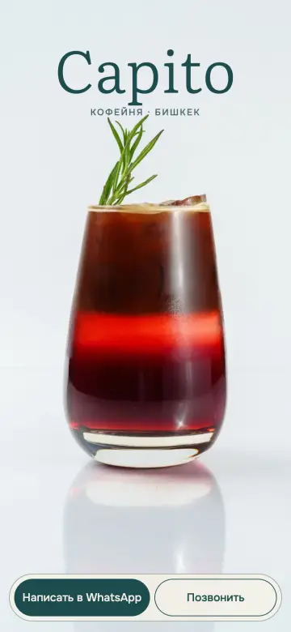
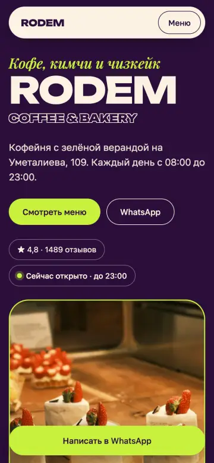
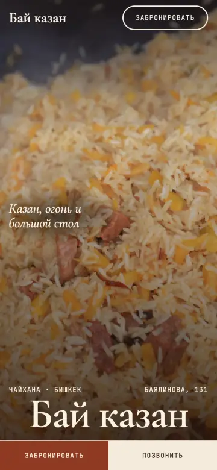
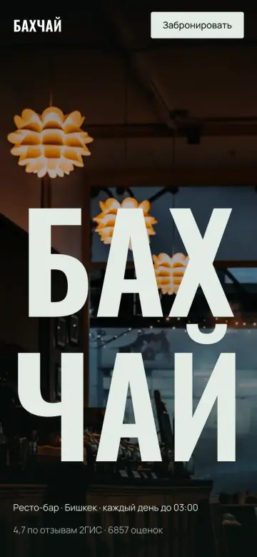

# cafe-demos

Four concept websites for cafes and restaurants in Bishkek. Each one is designed around the place itself (its menu, photos and atmosphere) rather than a shared template.

Live: https://handfooll.github.io/cafe-demos/

| | |
|---|---|
|  | [Capito](capito/), coffee shop |
|  | [Rodem Coffee & Bakery](rodem-bakery/), coffee, Korean food, desserts |
|  | [Bai Kazan](bai-kazan-chaikhana/), chaikhana |
|  | [Bahchai](bahchai/), late-night resto-bar |

Plain HTML, CSS and a little JS, no frameworks or build step. Responsive, with lazy-loaded images. Content is in Russian.

Concept designs, not commissioned by the venues.
